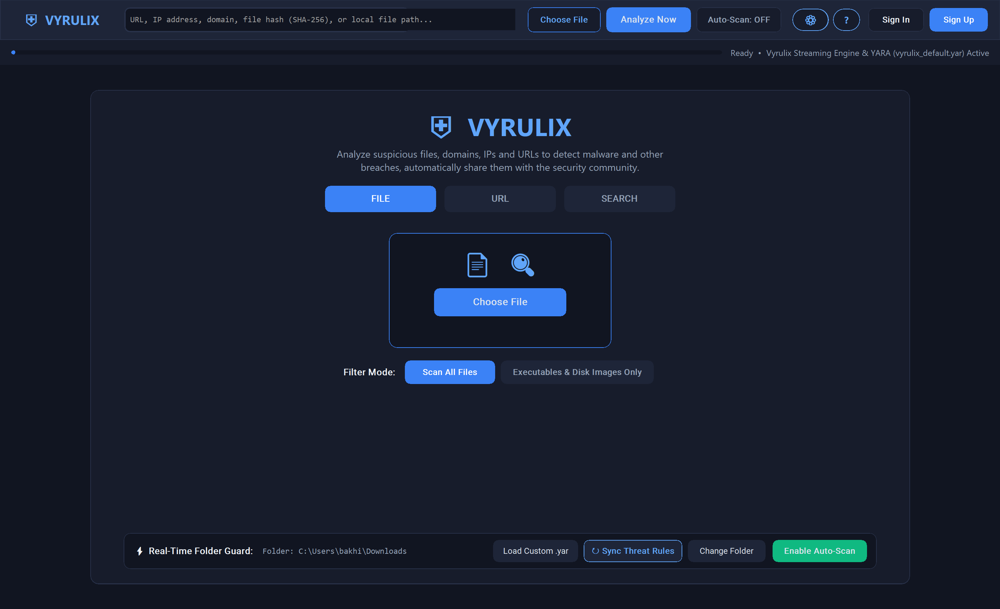
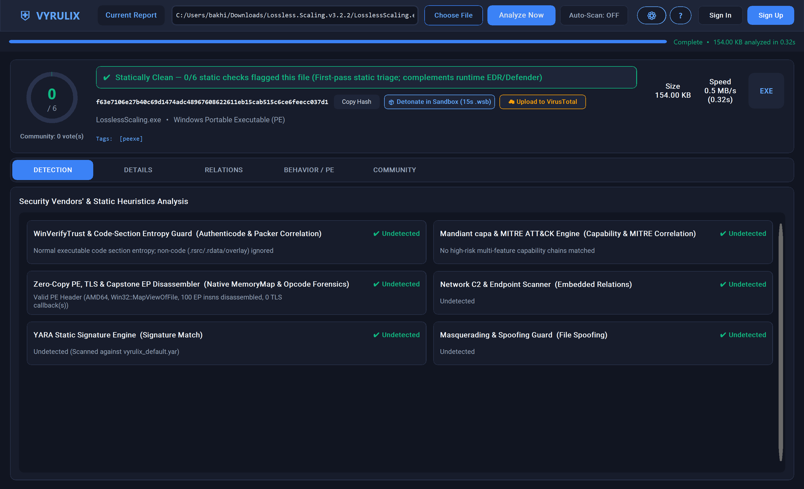

# ⛨ Vyrulix

| Detection & Triage Verdict | Deep PE, Disassembly & Behavioral Inspection |
| :---: | :---: |
|  |  |

**Vyrulix** is an open-source, bare-metal desktop malware triage and static threat intelligence workbench for Windows. It consolidates fragmented reverse-engineering workflows—bringing zero-copy PE inspection, entry-point disassembly, behavioral mapping, tri-hash variant clustering, and disposable sandboxing into a single, unified dark-mode dashboard.

> **Scope Note:** Vyrulix is an on-demand forensic triage and inspection station designed for malware researchers, SOC analysts, and students. It is **not** a real-time Ring-0 endpoint detection and response (EDR) agent. Always maintain active endpoint protection alongside this tool.

---

## ⚡ Core Capabilities

- **Zero-Copy Native PE Parsing (`MapViewOfFile`):** Inspects PE32/PE32+ headers directly in virtual memory with Win32 `\\?\` long-path support (>260 chars) and zero heap-copy bloat. Evaluates section entropy, Import Address Table (IAT) starvation heuristics, Export Table reflective loaders (`ReflectiveLoader`), and pre-entry-point TLS Callbacks (`T1055.005`).
- **Authenticode & Revocation-Checked Signature Guard:** Cryptographically verifies publisher signature chains and certificate revocation status (`WTD_REVOKE_WHOLECHAIN`) via Win32 `WinVerifyTrust` (`wintrust.dll`), suppressing benign generic-packer alerts on verified trusted software while catching untrusted or revoked signed-and-packed binaries.
- **Mandiant `capa` & MITRE ATT&CK® Mapping:** Translates API import chains, TLS hooks, and structural anomalies into actionable MITRE ATT&CK techniques and Malware Behavior Catalog (MBC) IDs (with optional standalone `capa` CLI integration).
- **Entry-Point Disassembly (`Capstone`):** Disassembles the first 100 instructions at `AddressOfEntryPoint` to flag packer stubs (`PUSHAD`/`PUSHFD`), unpacker decryption loops, PEB/TEB walks (`T1622`), and self-modifying code (SMC), backed by a built-in pure-Python x86/x64 fallback decoder.
- **Tri-Hash Variant Clustering:** Combines Mandiant `ImpHash`, `ssdeep` (CTPH), and `TLSH` locality hashing to cluster recompiled or repacked malware variants even when a cloud SHA-256 lookup misses.
- **Multi-Source Threat Intelligence Pipeline:** Queries **MalwareBazaar** and **ThreatFox** (abuse.ch) first, with a rate-limited **VirusTotal v3** consensus fallback and optional cloud upload for uncataloged (HTTP 404) samples.
- **Disposable 15s Windows Sandbox (`.wsb`) Detonation:** Stages targets under a sanitized static filename inside a read-only Hyper-V micro-VM with a hardened PowerShell monitor to intercept rapid parent-process exits, TCP/UDP beacons, and dropped child payloads (`cmd.exe`, `powershell.exe`, `rundll32.exe`, `mshta.exe`). *(Requires Windows 10/11 Pro, Enterprise, or Education with Windows Sandbox / Hyper-V enabled.)*
- **Real-Time Folder Guard & Local-First Analyst Notes:** Optional `watchdog` directory monitoring for automated triage of newly downloaded files, paired with local-first analyst notes and verdict history stored in `~/.vyrulix/community.json` (with optional `VYRULIX_API_PROXY_URL` sync).

---

## 🚀 Quick Start (Portable Windows x64)

For reverse-engineers testing inside disposable virtual machines, Vyrulix is packaged as a portable executable with zero Python dependencies required.

1. Navigate to the **[Releases](../../releases)** tab.
2. Download `Vyrulix-v1.1-win64.zip` and verify its SHA-256 hash against the release notes.
3. Extract the entire folder (keep `Vyrulix.exe` alongside its `_internal` directory) and run `Vyrulix.exe`.
4. *(Optional)* Click **⚙** in the top navigation bar to add your VirusTotal v3 API key or abuse.ch Auth-Key.

---

## 🛠️ Run & Build from Source

To run Vyrulix from source or build the standalone binary locally, ensure you have **Python 3.9+** installed on Windows.

### 1. Clone & Run
```bash
git clone https://github.com/bakhishovism/Vyrulix.git
cd Vyrulix
pip install -r requirements.txt
python main.py
```

### 2. Build Portable Executable (PyInstaller)
```bash
python build_vyrulix.py
```
The compiled portable bundle will be generated at `dist/Vyrulix/Vyrulix.exe`.

---

## 📁 Project Structure

```text
Vyrulix/
├── main.py              # CustomTkinter dark-mode UI, report panes, and async worker queue
├── scanner.py           # Zero-copy PE parser, Capstone disassembler, YARA, capa, & .wsb sandbox engine
├── community.py         # Local-first analyst accounts, verdict tallies, and PBKDF2 credential storage
├── build_vyrulix.py     # PyInstaller 6.x spec generator and portable bundle builder
├── requirements.txt     # Python dependencies
└── screenshots/         # UI preview images
```
